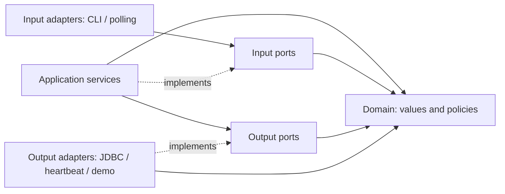

# Implementation reference

Detailed design decisions and validation coverage for the fan-out worker. For setup and everyday commands, start with the [README](../README.md).

## Components and boundaries

The implementation uses hexagonal architecture within **one Maven module and one deployable application**. Ports describe capabilities; adapters implement or invoke them. Source dependencies point toward application/domain, and `bootstrap` wires the concrete implementations.

```text
com.caseware.fanout
├── domain
│   ├── model           Top-level records and enums
│   ├── policy          Policy, TaskCompletionPolicy
│   ├── exception       Specific domain failures and stable codes
│   └── validation      IdentifierValidation
├── application
│   ├── port/in         PlanPublication, DispatchPendingTasks, ProcessNextTask, InspectWork
│   ├── port/out        Inventory, JobStore, MessageQueue, EngagementGateway, LeaseHeartbeat
│   ├── exception       Configuration, inventory, resource and persistence failures
│   └── service         FanOutPlanner, OutboxDispatcher, FanOutWorker, WorkInspection
├── adapter
│   ├── in/cli          DemoRunner
│   ├── in/polling      WorkerRuntime
│   ├── out/persistence SpringDataStore, DatabaseClock, entities and repositories
│   ├── out/scheduling  ScheduledLeaseHeartbeat
│   └── out/demo        DemoInventory, DemoEngagementGateway
└── bootstrap           Application, configurations and typed properties
```

The diagram shows source dependencies, not message order. Dashed arrows mean interface implementation.



| Component | Responsibility |
| --- | --- |
| `FanOutPlanner` | Fetch a bounded page, validate it and atomically checkpoint tasks/outbox/cursor. Repeating `step` resumes progress. |
| `OutboxDispatcher` | Send notifications before marking them published; crashes between those steps produce safe duplicates. |
| `FanOutWorker` | Claim, admit, reconcile/invoke, persist completion, then acknowledge. |
| `WorkInspection` | Bounded inspection through the job-store port. |
| `WorkerRuntime` | Fixed local concurrency, dispatch/polling loop and shutdown. |
| `ScheduledLeaseHeartbeat` | Renew ownership and message visibility on a separate scheduler. |
| `SpringDataStore` | Atomic job-store and queue operations over Spring Data JDBC repositories. |
| `DatabaseClock` | PostgreSQL time for replica coordination. |
| `TaskCompletionPolicy` | Pure decisions about stale/conflicting results, retry budgets, Retry-After and withdrawal. |

`bootstrap` knows concrete classes; the domain knows only Java, and application code knows its ports/domain/JDK. Input adapters invoke input ports rather than concrete services or JDBC. Output adapters cannot invoke use cases. ArchUnit enforces these dependency boundaries.

Ports expose meaningful atomic operations such as `savePage`, `admit` and `complete`, not generic CRUD. Completion checks ownership, evaluates the domain policy and commits projection/task/capacity changes together. Replacing an adapter requires preserving those semantics, not just implementing method signatures.

### Records versus Lombok

Each domain type has its own file. The ten value/snapshot types are records (`Engagement`, `Publication`, `Candidate`, `Page`, `Run`, `Task`, `Claim`, `Delivery`, `Metadata`, `RemoteResult`); `State` and `RemoteState` are enums. `IdentifierValidation` centralizes required-identifier rules. Persistence records are separate, keeping Spring annotations out of the domain.

Records provide immutable fields, value equality and constructor validation without another dependency. `Task` and `Run` are snapshots: changing an in-memory object cannot claim a task or commit a state transition. `Page` defensively copies its list because records are shallowly immutable. IDs are used explicitly where identity matters.

Lombok `@Value` is an alternative but adds annotation processing without a current need. `@Data` setters would be inappropriate for these snapshots. A future aggregate with identity-based equality or controlled mutation can use an explicit class, optionally with selected Lombok annotations. Builders or JavaBean accessors should be introduced for an actual requirement rather than uniformly replacing records.

## Database migrations and Spring Data

Liquibase owns DDL. The PostgreSQL [master changelog](../src/main/resources/db/changelog/postgresql/db.changelog-master.xml) includes separate SQL files before storage initialization and worker startup:

| Changeset | Contents |
| --- | --- |
| `001-baseline` | Seven application tables, primary/unique keys and foreign keys. |
| `002-indexes` | Visibility index, partial active-reservation/pending-outbox indexes and dispatch sequence. |

Liquibase records checksums/history and coordinates migrations. Partial unversioned schemas and checksum mismatches fail rather than replacing data. Add a changeset after deployment; do not edit applied SQL, clear checksums to conceal changes or use `runOnChange` for structural migrations. QA/PROD migrations must run once in a future deployment job before replicas, with startup migrations disabled. The current pipeline prepares environments but does not deploy or migrate them.

The original H2 changelog is retained unchanged as history but is not selected, and H2 is not packaged. A URL change does not transfer data. An existing installation needs a planned export/import: stop writers, back up all seven tables, preserve IDs/cursors/tokens/receipts and reservations, validate imported data, and advance the message identity and dispatch sequence beyond imported values. Do not copy H2 Liquibase history into PostgreSQL history. Data transfer and destructive rollback are not automated; use forward migrations or a verified backup.

Repositories use explicit named SQL queries and `@Modifying` writes. `TransactionTemplate` uses `READ_COMMITTED` and `REQUIRES_NEW` so each port operation is its own durable boundary. Repository calls within it share a transaction; remote calls remain outside it. A generic save of a detached task would not preserve ownership/admission guarantees.

Metadata uses the composite `(firm, engagement)` key and PostgreSQL `ON CONFLICT`. A transaction-scoped advisory lock covers its read/decision/write even when the row does not yet exist. PostgreSQL `clock_timestamp()` supplies production scheduling time, and ownership checks refresh database time after acquiring locks. Only the package-private deterministic test seam accepts supplied time.

### Concurrency across replicas

The general transaction helper does not lock the global control row.

| Operation | Coordination |
| --- | --- |
| Receive | `FOR UPDATE OF m SKIP LOCKED` skips messages held by other consumers. |
| Task claim, renewal or transition | Lock its task row; validate lease and fencing token. |
| Planning page | Lock its publication; tasks/outbox/cursor commit atomically. |
| Execution/completion target check | Shared publication lock, excluding withdrawal while permitting other executions. |
| Metadata update | Advisory transaction lock per firm/engagement. |
| Capacity, start rate and circuit transitions | Short admission-control lock. |
| Inspection | Ordinary reads without admission-control locking. |
| Firm rotation | PostgreSQL sequence plus selected firm's dispatch turn. |

Strict shared limits still need atomic admission coordination. That lock is not held during remote calls, queue polling, claim/heartbeat operations or ordinary reads; completion acquires it briefly for circuit accounting. This reduces contention without promising unlimited throughput. Execution follows task, publication, projection when needed, then admission-control locking; holding admission control never leads to acquiring another task's lock. Partial indexes keep completed task history out of reservation counts. Lock waits have a configurable timeout, default five seconds.

Firm rotation is approximate under concurrency, not strict weighted fairness. Per-firm limits complement scheduling. Publication/backfill priority classes are not separately weighted. The SQL queue is an adapter behind `MessageQueue`, not an SQS integration; a future broker adapter must preserve receipt fencing, visibility and recovery behavior.

## Correctness, capacity and recovery

- Publication identity is immutable within a region. Tasks are unique by publication run/firm/engagement; page tasks, outbox and expected cursor commit together.
- Inventory needs stable snapshot/keyset cursors. Pages are bounded to 1,000 candidates. The caller chooses missing/stale/sample candidates; the full weekly sampler and unknown-product discovery are outside this component. Healthy metadata is not invalidated by publication.
- Increasing claim tokens fence late workers. Lease/visibility expiration never releases remote capacity. Projection decisions reject stale revisions and conflicting equal revisions.
- `maxActive` and `maxPerFirm` count durable remote reservations, not local threads. Execute requests also pass the shared start-spacing gate. Budgets must exclude capacity reserved for interactive traffic.
- Persist completion before acknowledging. A crash before acknowledgment re-delivers a terminal task without executing it again. A remote-success/local-commit failure recovers by querying remote status.

### Required remote contract

`EngagementGateway.execute(operationId, engagement)` models the blocking call. The remote owner must durably deduplicate concurrent and late requests with the same ID and retain terminal outcomes throughout the recovery horizon. `lookup` must not start work. Configure real transport timeouts from the owner's latency distribution; a timeout or interruption does not prove remote cancellation.

Allocate an operation ID durably before sending. Unknown outcomes retain the reservation and attempt: recovery polls status, defers running work, finalizes terminal work, or resubmits a not-found operation with the **same ID** through the rate gate. A new ID is allocated only after a definite terminal retryable failure. Unresolved operations may hold capacity indefinitely; the design does not guess that work stopped. Status endpoint capacity must also be agreed with the owner. Exactly-once external execution is not promised without that cooperation.

### Failures and retries

Known transient terminal failures use persisted capped exponential backoff with equal jitter and a maximum-attempt budget, honoring a later `retryAfter`. Disable hidden transport load retries: there is one retry layer. Permanent file errors end as `FAILED` and remain inspectable rather than requiring another dead-letter service.

The shared circuit breaker blocks admissions after dependency failures and permits one half-open probe. File-specific permanent errors do not open it. Capacity/circuit deferrals do not consume another attempt. Withdrawal supersedes unadmitted work; reserved operations are reconciled before releasing capacity. The worker updates verified metadata, not template acceptance/application state.

### Semantic exceptions and readable orchestration

Domain/application failures have specific types and stable enum codes via `code()`. Domain exceptions depend only on Java; storage translates Spring data/transaction failures after rollback and keeps the original cause in `PersistenceOperationException`. Domain/configuration errors propagate unchanged. Programming faults are not blanket-wrapped as storage failures.

| Exception | Meaning |
| --- | --- |
| `InvalidIdentifierException`, `InvalidRevisionException` | Invalid identifier or negative snapshot revision. |
| `MissingCandidateEngagementException`, `InvalidPageCandidatesException` | Missing engagement or invalid page candidates. |
| `MissingRemoteStateException`, `MissingRemoteMetadataException` | Missing remote state or success metadata. |
| `InvalidAdmissionLimitsException`, `InvalidPolicyDurationException`, `InvalidPolicyTimingException`, `InvalidRandomSampleException` | Specific admission/timing/jitter rule violations. |
| `RegionMismatchException` | Operation crosses the configured regional boundary. |
| `PublicationConflictException`, `RevisionConflictException` | Conflicting publication identity or metadata revision. |
| `InvalidTaskStateException` | Completion requested without a resolved remote result/reservation. |
| `InvalidConfigurationException`, `InventoryContractException` | Invalid settings or inventory contract. |
| `ResourceNotFoundException` | Missing task/publication; `resource()` identifies its kind. |
| `PersistenceOperationException` | Storage failure; `operation()` names the boundary and `getCause()` retains the technical error. |

`DomainException` remains an abstract base. Validation exceptions have fixed messages/codes, not arbitrary caller-supplied classifications. Some distinct types retain the same broader code category. `DemoExecutionException` belongs to the CLI adapter. Framework startup errors retain their framework cause chain.

Every catch logs recovery or propagates, preserving causes when wrapping. Logs contain semantic codes or exception classes, not tenant payloads/stack traces. Technical causes may contain SQL and are for controlled diagnostics, not public responses. Interruptions restore the flag and are logged; renewal failures leave later heartbeats scheduled and reservations retained. Concurrent control initialization uses `ON CONFLICT DO NOTHING` and verifies shared configuration.

The worker orchestrates short claim/admission/reconciliation/completion helpers. Only the gateway invocation is inside the remote-error catch; persistence and acknowledgment failures propagate. Empty reconciliation means deferred work, not successful completion. Store helpers remain inside original atomic boundaries; the completion policy separately handles success and retry decisions.

## Validation and production limits

| Command | Tests executed | Database required |
| --- | --- | --- |
| `mvn test` | Surefire: `*Test` (unit, configuration binding and architecture checks). | No |
| `mvn verify` | All unit tests, then Failsafe: `*IT` (integration), with failures checked in `verify`. | PostgreSQL |

Application unit tests instantiate the worker directly and mock `JobStore`, `MessageQueue`, `EngagementGateway` and `LeaseHeartbeat`. They verify orchestration and failure decisions without starting Spring, JDBC or Liquibase. Mockito uses interface proxies and reflection, so these tests require no JVM instrumentation agent; mock ports rather than concrete adapters. Configuration-binding tests load properties without creating a datasource. Keep database fixtures (`TestDatabase`, `PersistenceTestContext`, `TestSupport`) confined to integration tests. New tests that open a database connection must use the `*IT` suffix; pure tests use `*Test`.

Integration tests retain real PostgreSQL coverage for SQL, transactions, migrations, row locking, concurrency, crash recovery and Spring wiring. Mocks cannot prove these guarantees. `mvn verify` never silently substitutes H2 or skips integration tests. Without overrides, `src/test/resources/test-database.properties` selects the local Compose database: localhost:15432/fanout, user `fanout`, password `fanout-local-only`. These test-only defaults also work when Maven or JUnit is launched from IntelliJ. Use `TEST_DATABASE_URL`, `TEST_DATABASE_USERNAME` and `TEST_DATABASE_PASSWORD` for a dedicated database/account with schema-creation permissions. Each fixture creates a random schema; its JVM cleans up only its own schemas on normal exit. A forcibly terminated test JVM may leave schemas for manual cleanup.

Reports are written to `target/surefire-reports` (unit) and `target/failsafe-reports` (integration). CI first runs `mvn test` in a job without a database service or database credentials, then runs the complete `mvn verify` lifecycle in a separate job with disposable PostgreSQL. Both report sets are retained. To select a single class, use `mvn -Dtest=FanOutWorkerTest test` or `mvn -Dit.test=PostgresConcurrencyIT verify` (the latter still runs unit tests).

Java conventions require explicit types, braces on control-flow bodies, imports instead of fully qualified method-body references, short responsibility-based methods, and observable/propagated failures. [Checkstyle](../config/checkstyle.xml) enforces explicit types and braces during `validate`, including tests. Conventional `else if` is allowed. `mvn validate` checks style only.

| Area | Evidence |
| --- | --- |
| Application unit tests | Mocked ports: duplicate deliveries, unavailable claims, withdrawals, admission/submission denial, same-ID recovery, remote uncertainty, lost ownership and storage cause preservation. |
| Concurrency | Multiple workers/adapter instances share global/per-firm capacity, rate limits and one circuit probe. |
| Idempotency | Concurrent planners, page replay, repeated publications and duplicate notifications. |
| Local failure recovery | Page rollback, send-before-outbox-mark, completion-before-ack and remote-success-before-local-commit failures. |
| Process failure | Child JVM halts after reservation; parent reconnects and recovers with the same operation ID. |
| Remote uncertainty | Timeouts retain capacity; old running operations are reconciled; stale claims cannot commit. |
| Progress | Firm rotation, heartbeat, capped retries, Retry-After, withdrawals and stale-result rejection. |
| PostgreSQL lock scope | Locked admission does not block reads/claims/renewals; locked messages are skipped; other publications progress; concurrent projections preserve newest metadata. |
| Clock authority | Skewed host timestamps cannot steal production leases. |
| Migrations | Fresh schema, incremental upgrade preserving reservations, restart, partial-schema rejection and checksum validation. |
| Spring/configuration | Profiles, secret binding, missing credentials, pool/session overrides, demo isolation and executor shutdown. |
| Domain/architecture | Pure completion-policy tests and ArchUnit dependency checks. |
| Exception semantics | Typed conflicts, resource kinds, cause preservation and rollback/recovery after translation. |
| Pipeline preparation | Offline Python tests for QA/PROD validation, invalid inputs and absence of secret values in output/summaries. |

Run the pipeline-validator tests locally with `python -m unittest discover -s .github/scripts -p 'test_*.py'`. CI also runs the container smoke script with two local-profile processes and a subsequent restart against one disposable PostgreSQL container. That demonstrates coordination in the no-failure fake-service path, not remote durability.

All replicas in a region must share one database/schema and policy. A database per replica creates independent budgets. Budget connections across replicas (defaults local 8, QA 12, PROD 24), use regional TLS/backup/failover infrastructure, and monitor queue age, outbox lag, lock waits, unknown outcomes and retained reservations. The code does not provision cloud infrastructure or supply authentication, a monitoring stack or real external adapters. Tests do not establish five-second production SLOs, 800,000-file throughput, regional compliance or downstream behavior.

References: [Spring Boot configuration](https://docs.spring.io/spring-boot/3.5/reference/features/external-config.html), [Spring Data JDBC queries](https://docs.spring.io/spring-data/relational/reference/jdbc/query-methods.html), [PostgreSQL locks](https://www.postgresql.org/docs/17/explicit-locking.html), [PostgreSQL SKIP LOCKED](https://www.postgresql.org/docs/17/sql-select.html), [Java records](https://docs.oracle.com/en/java/javase/21/language/records.html), [Hexagonal architecture](https://alistair.cockburn.us/hexagonal-architecture), [ArchUnit](https://www.archunit.org/userguide/html/000_Index.html), [GitHub environment jobs without deployment](https://docs.github.com/en/actions/how-tos/write-workflows/choose-what-workflows-do/deploy-to-environment).
